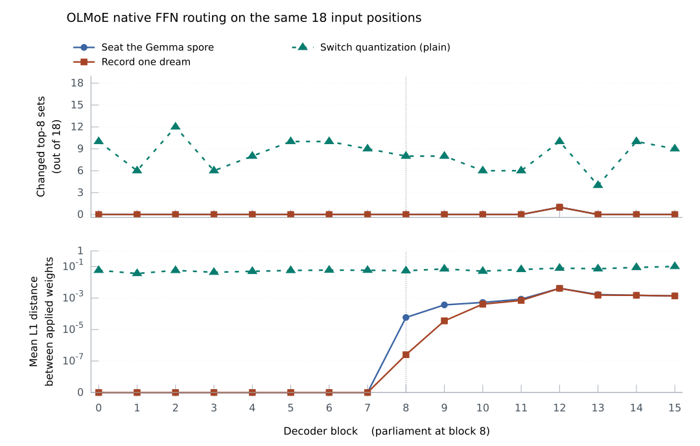

# Democracy of Experts in the notorch harness: claims and probes

Democracy of Experts (DoE) is an inference architecture of the Arianna Method that wraps a frozen
language model in a small population of low-rank experts. The experts vote on every token, split
when they carry the load, die when they carry none, and can adjust their own weights between turns.
The standalone implementation keeps a parliament at every layer. In the notorch CPU Harness,
`--experts` seats a parliament at the middle decoder block. It writes its own GGUF, can
consolidate on a worker and can resume on another set of weights. Sections 1 and 2 describe
the standalone design. Sections 3 and 4 follow the arithmetic into the Harness and show how a
dream can change the next forward. Section 5 retains the original twenty research questions.
The `doe/doe.c` line references use the [standalone source at `7265af0`](https://github.com/ariannamethod/doe/blob/7265af09a91301cd84318dbdeb7d101398de92e0/doe.c).

## 1. What DoE is

OLMoE trains a bank of feed-forward experts at each block. During inference its router scores
every bank and executes the top k. DoE adds a population whose size and weights can change between
turns. Both populations participate in the same forward when a sparse body hosts the parliament.
[Sparse decoder](../harness/arch_olmoe.c)

Per host layer, `doe.c` keeps a parliament of 2 to 16 experts (`doe/doe.c:111-112`). An expert is a
pair of thin matrices, A [dim, rank] and B [rank, dim] with rank 16, plus a frequency, a vitality
between 0 and 1 and an age (`doe/doe.c:114, 2153-2165`). Applied to the hidden state x, the vector
the layer carries for the current token, it adds A(Bx), a correction confined to a 16-dimensional
subspace: the LoRA construction (low-rank adaptation), applied after the host's attention step and
before its feed-forward step (`doe/doe.c:3730-3753`). Each token and layer holds an election, and the
elected corrections are summed with softmax weights. Between elections the population changes: a
high-vitality expert splits (mitosis), one whose vitality stays low for eight updates is deleted
(apoptosis), and with learning on the matrices follow a Hebbian rule, which strengthens connections
between signals active together, rewarded by what `doe.c` calls prophecy debt. The population can be
saved as a spore and restored when the same host loads again.

`doe.c` writes the arrangement as θ = ε + γ + αδ (`doe/doe.c:8-12`): ε is the host, mapped read-only
from its GGUF file (the model container format) with `PROT_READ` (`doe/doe.c:2462`); γ is the
parliament; δ is a physics layer that reshapes the output logits, the model's raw next-token scores;
α is an injection strength. The claims concern γ. δ enters through the harmonic state used in votes
and the debt used as a learning signal, and the probes hold it still with `--field-gain 0`
(`doe/doe.c:931, 5257`) and a fixed `--temp` (`doe/doe.c:4427, 5261`).

## 2. The standalone mechanism in doe.c

Each living expert votes `w_vote[e]·x + 0.1·resonance(freq_e)` (`doe/doe.c:2897-2901`), where
resonance weighs how close the expert's frequency lies to each bin of an 8-bin Fourier decomposition
called the harmonic state (`doe/doe.c:2018-2045`). The consensus is a running average, weighted 0.9
on the past, of the relative spread of the votes, sqrt(variance) over (mean magnitude + 1), capped at
1 (`doe/doe.c:2904-2913`): votes far apart raise it, bunched votes lower it. The electorate is
k = floor(n_alive × (1 − consensus)) clamped to [2, n_alive] (`doe/doe.c:2915-2916`), chosen by
highest vote and weighted by a softmax (`doe/doe.c:2918-2931`). The vote matrix is drawn once from a
normal distribution with standard deviation 0.01 (`doe/doe.c:2796-2800`); no code changes it
afterwards except the restoration of a spore (`doe/doe.c:3340`).

In the chat loop, every ten generated tokens each layer runs a vitality update and then at most one
split and one death (`doe/doe.c:4457-4469`); the HTTP generation path has no such step
(`doe/doe.c:4706-4753`). The update moves vitality by 0.05 × (tokens_seen / fair share − 1), clamps
it to [0, 1], increments age and counts consecutive updates below 0.1 (`doe/doe.c:3068-3086`). A split
needs vitality above 0.8 and age above 20 updates; the child copies the parent's A and B plus
N(0, 0.01) noise and starts at vitality 0.5, and the parent's vitality is multiplied by 0.8
(`doe/doe.c:3088-3111`). Death needs eight consecutive low updates and stops at two experts
(`doe/doe.c:3113-3126`).

With `--train 1`, each generated token adds its activations and a signal to a per-turn accumulator:
−d when the prophecy debt d exceeds 0.3, otherwise 0.1 × (1 − d) (`doe/doe.c:4454-4455`), where debt
is d/(d+1) with d the gap between the top logit and the chosen logit (`doe/doe.c:814-820`). After
the turn each expert elected during it receives one Oja update on the turn's mean activations
(`doe/doe.c:3043-3063, 4480`). Oja's rule is a Hebbian update with a term proportional to the weight
itself, which for a positive step keeps weights from growing without bound; A and B both follow it,
on four of sixteen rank components at a time (`doe/doe.c:2943-2983`). The default is `--train 0`
(`doe/doe.c:139`).

A spore is a binary file named by the host's fingerprint, a hash over per-layer weight statistics
(`doe/doe.c:2132-2142`), and the step count; it stores each layer's vote matrix and consensus and,
per living expert, vitality, frequency, A and B (`doe/doe.c:3263, 3275-3290`). The expert struct also
declares `specialization`, `attention_bias` and `layer_focus`, and the parliament struct
`faction_power`; no code reads them (`doe/doe.c:2158-2170, 2382-2383`).

Where the architecture note (`doe/docs/doe_architecture.md`) and `doe.c` differ, this document follows
`doe.c`. The note describes the update as per token with multiplicative decay (:252-300), the vote
matrix as learned (:211), α as per layer and derived from profiling (:102), and age as tokens since
birth (:166). In `doe.c` the update is Oja's, once per turn, off by default; the vote matrix is
fixed; α is one scalar, 0.1, copied at load (`doe/doe.c:612, 2452, 3750`), with profiling affecting
only the initial size of experts in layers scoring below 0.5 (`doe/doe.c:2808-2814`); and age counts
vitality updates (`doe/doe.c:3080`). doe's own battery (`doe/tests/test_doe.c`, 113 tests, recorded
passing at `doe/DOELOG.md:38`) tests each function alone and includes `doe.c` to reach its static
functions (:18-19); its one spore test checks a file-name pattern (:1389-1396).

## 3. The arithmetic and its tests

notorch carries three functions with the same formulas as caller-owned arithmetic:
`nt_parliament_elect_values` returns gates and the next consensus, `nt_parliament_inject_values`
returns x + α·Σ gate_e·A_e(B_e x), and `nt_oja_values` returns the Oja update of one expert with an
explicit rank cursor and caller-supplied noise (`notorch/notorch.h:1029-1066`, `notorch/notorch.c:530-717`).
The header assigns lifecycle, rewards, clocks and random numbers to the caller and promises that a
failed call preserves every output byte (`notorch/notorch.h:1029-1033`).

The first battery, `notorch/tests/test_parliament_values.c`, runs under `make test` and reports
`PARLIAMENT_VALUES_OK` with its check count. `election()` (l.22-61) asserts hand-computed results on four
experts: votes −3, −1, 1, 3 give consensus 0.55 and two elected experts at the softmax of the top two
votes (l.23-27); dead slots receive nothing (l.31-33); fewer live experts than the minimum give zero
gates and k = 0 (l.34-36); equal votes elect three experts at gate 1/3 (l.37-40); malformed input
returns −1, with the output buffer compared byte for byte after the 17-expert and overflow cases
(l.46-59). `injection()` (l.63-107) matches a double-precision recomputation at 3 experts, dimension
5, rank 2 within 2e-7 (l.70-78), shows that NaN inside an expert with gate 0 never reaches the
output (l.81-84), and that alpha 0 or all-zero gates return x unchanged (l.85-90). `oja()`
(l.109-145) checks the explicit update on a 3×4 fixture inside a window of 2 that wraps from cursor 3
to 0 and leaves the other components untouched (l.118-127), and that signal 20 equals signal 2
(l.115-117). `private_cursors()` (l.147-162) shows four experts with a window of 4 on rank 16 each
touching every component in four turns, and `owners_and_tape()` (l.186-203) shows eight threads of 64
turns each equal to a serial run byte for byte, with an active autodiff tape unchanged. The
assertions establish that the arithmetic matches the header's equations on small fixtures, the
largest of dimension 5, and that bad input is refused without side effects. They never call
`doe.c`, and they contain no transformer, vitality, split, death, harmonic state, spore or activation
accumulator.

The second battery, [`test_wt_expert.c`](../tests/test_wt_expert.c), also runs under `make test`.
It exercises `wt_expert`, which slices one pretrained FFN expert out of a stacked weight.
With five experts of four rows and 256 columns, each row filled with its own index, it asserts that
every slice of a packed Q4_0 weight and of an f32 weight starts at row 4e and holds 4 rows
(l.48-62, 73-87), and that an index past the end, a negative index and a weight without data are
refused (l.92-97). That proves the row-offset arithmetic for two storage forms. The test's header
names Q6_K as the type where the offset is easy to get wrong (l.4-7), and the test does not cover
it. It involves no routing, no gating and no change to an expert.

Two further tests exercise the corresponding Metal kernels on Apple hardware.
[`test_parliament_elect.c`](../tests/test_parliament_elect.c) compares elections with the
CPU formulas. [`test_parliament_inject.c`](../tests/test_parliament_inject.c) compares the residual updates.

## 4. The parliament in the Harness

### Who owns a turn

One conversation owns six seats, four initially occupied, each with rank-4 A and B. At the
middle block, every input token contributes a sample to the harmonic history. The living
seats vote on the residual after the block's attention or short-convolution mixer. The Harness adds their weighted low-rank
correction there, lets the body execute its feed-forward block, and observes the resulting
residual. A completed learning turn supplies a pair of mean residuals and the mean prophecy
signal. Each seat elected during the turn takes one Oja step at its own rank cursor. The owner
then updates vitality, births and deaths. A background worker takes sole ownership of this
state during consolidation and returns the committed generation for the next forward.
[Decoder boundaries](../harness/arch.h) · [Turn state and consolidation](../harness/experts.c)

### What survives a change of body

An exact spore restores the finished parliament on the same GGUF, identified by its SHA-256.
It carries A, B and the vote rows, the population and its vitality, ages and frequencies,
consensus, residual history, per-seat cursors, random-generator state and clocks. The next
conversation starts with fresh model caches. A portable spore adds a coordinate frame. Each
body runs the same 32 literals through its own tokenizer and decoder, each starting at
position zero. Calibration takes their last-token residuals at the intervention point and
orthogonalizes them in order. The resulting 32 axes span part of each body's residual space.
When family, width, depth and the digest of the normalization weights match, and each axis
turns less than 45 degrees, the recipient copies the expert weights. Otherwise it transfers
the 32 measured components of each vote row, A column and B row into the receiving frame.
The other components come from the recipient's own
initialization. A seat keeps its history across this change of coordinates.
[Calibration and projection](../harness/spore_frame.c) · [Cross-body AML experiment](../experiments/doe_spores/portable.aml)

A dream uses these same axes. The parliament chooses an unused cue by the sum of its living
seats' vitality-weighted response energies, `Σ vitality_e ‖A_e B_e q‖²`. The body decodes
that cue with a private cache. A preview exposes its choices in the trace. Recording the
episode commits the elected seats' factors and cursors, the random-generator state, and
a separate clock for sleep. Each private choice is greedy. Its chosen and best logits
coincide, so its scalar learning signal is +0.1. The elected seats and the observed
input and output residuals determine which low-rank components move. The waking consensus, harmonic history and vitality carry through
the episode. This gives a matched experiment on any receiving body. Restore the spores saved
before and after one dream and present the same prompt to each. In the Gemma 270M → Qwen3.5
→ Gemma 270M experiment the two Qwen generations chose the same twelve tokens on a fixed
prompt. After both spores returned to the original Gemma weights, choice eleven differed.
[Dream and commit](../harness/dream.c) · [Measured round trip](../experiments/doe_spores/gemma3.aml)

### Two selections on a sparse body

On a sparse block the word *expert* names two populations. A parliament seat has a vote,
vitality and portable A/B factors. A pretrained FFN expert belongs to one block of one
weight file. The parliament's election produces a corrected residual `x′`. The block's
router reads `z = RMSNorm(x′)`. Each native expert has a router row `w_i`, and its
score is `w_i · z`. OLMoE takes the top k and uses their probabilities from the softmax
over all native experts. The `qwen3moe` family normalizes the selected weights to sum to one.
[Sparse decoder](../harness/arch_olmoe.c) · [OLMoE pretraining architecture](https://arxiv.org/abs/2409.02060)

The boundary between native experts i and j lies where `(w_i − w_j) · z = 0`. A learned
change in A/B can carry the residual across the top-k boundary while both router rows
stay fixed. It can also change the mixture weights while retaining every selected expert.
To observe either effect, replay identical token IDs from fresh caches and align the two
routes by layer and absolute token position. Blocks below the parliament see the same
inputs. At the parliament's block, compare the living-seat gates, the native expert IDs
and their mixture weights. On the same body, spores taken immediately before and after a
dream elect the same seats on that replay. Their updated factors can supply a different
correction. The spore carries the living seats. Each native expert ID belongs to the
receiving body's own router at that particular block.

On the official OLMoE-1B-7B-0924-Instruct Q4_0, the spore saved after one
Gemma waking turn was projected from width 640 into a 2,048-dimensional residual. OLMoE selected the cue
` sleep`. On that input, living seats 1 and 3 received gates 0.648 and 0.352.
The router in their block executed banks 22, 7, 29, 60, 32, 1, 33 and 59, listed
in the order their outputs were summed. Across the seven private input positions
seats 0 and 1 each spoke six times and seats 2 and 3 once each. All four wrote
their A/B factors and cursors to the spore.

The comma in “At the lighthouse, Miro reaches for his” makes the effect visible
on replay. It is input ID 13 at position 4. In block 12 its eighth native FFN
expert was bank 38 in plain inference, 28 after seating the imported parliament
and 38 after OLMoE recorded its dream. At block 8 the native top-eight membership
and order had held across both probes while the applied weights moved. The
two archived parliaments cast identical living ballots on all 18 input positions.
Copying only the four founders' post-dream A/B into the pre-dream archive
reproduced all 288 native routes and both 50,304-entry logit vectors exactly.
This intervention holds the waking archive's cursors and clocks fixed while
restoring the learned correction that the router and output head read.

The same parliament can meet a different routing geometry when the weight file changes.
The official Q4_0 and Q4_K_M bodies contain identical F32 router matrices at all 16 blocks
(8,388,608 bytes in total). With plain inference, switching bodies changed which eight banks
ran at 132 of the 288 matched block/position pairs. The other weights influence the vector
that reaches each fixed router. When both recorded histories crossed to Q4_K_M, the receiving
body recalibrated the 32 anchors and preserved every byte of the living A/B and voting vectors.
On “At the lighthouse, Miro reaches for his”, the awake history generated “ bag” and the
post-dream history generated “ phone” as their first token. On Q4_0 both generated “ bag”.
[Router and spore tensors](../experiments/doe_spores/olmoe-tensors.tsv) ·
[Weight-swap routes](../experiments/doe_spores/olmoe-quantization.tsv)

Each block aggregates the same 18 positions across two prefixes. The upper panel counts changes
in top-eight membership. On Q4_0 both parliament interventions cross that boundary at the same
comma in block 12, so their curves coincide. The lower panel measures the mean L1 distance
between native mixture weights, giving unselected banks weight zero. Its bottom tick marks
exact equality and positive values use a logarithmic scale.
[Per-block measurements](../experiments/doe_spores/olmoe-routes.tsv) ·
[Reproduce the comparison in AML](../experiments/doe_spores/olmoe.aml)

Repeated sleep can move a preference in either direction with the waking history fixed. After
one, two, four and eight private episodes on Q4_0, the log odds of ` key` over ` bell` for
“Every night the lighthouse keeper carries a” shifted by +0.021, −0.086, +0.031 and −0.045
from the waking spore. At eight episodes the archive still recorded one waking turn and 24
waking elections, alongside 48 private choices and 56 private elections.
[Sleep series](../experiments/doe_spores/olmoe-sleep-series.tsv)

### A parliament on a hybrid decoder

An LFM3 sequence has two forms of short-term state. The short convolutions
carry a window of gated inputs and the attention blocks retain keys and values.
On the official LFM3-Omni-2B text body there are 24 decoder blocks and 11
attention-cache slots. Counting the blocks places the parliament at block 12,
which uses sliding-window attention. Its output is added to the residual before the living
seats vote. The weighted correction enters the next feed-forward computation.
Capturing the 32 calibration literals at this same boundary lets the hybrid
receive a spore from a dense or sparse host.
[LFM3 forward and cache](../harness/arch_lfm3.c) · [Calibration](../harness/spore_frame.c)

Restoring a spore starts a new sequence. The archive carries the learned A/B
and votes. The new body's convolution windows and attention cache fill from the
new inputs. A private dream starts with fresh windows and an empty attention
cache and builds both from its cue and subsequent choices. In one
six-choice dream the Omni Q4_K_M body chose ` sleep` on every step. Seats 0, 1
and 3 won seven, four and three elections respectively. Those three seats wrote
their factors and cursors. Seat 2 held its prior values. On two fixed prompts
the awake and post-dream parliaments cast the same 17 ballots, yet their final
logits differed. Copying only the four founders' A/B from the dream restored
both full output vectors.
[Scores](../experiments/doe_spores/lfm3-scores.tsv) · [Seat writes](../experiments/doe_spores/lfm3-writes.tsv)

The receiving weights determine whether a learned change crosses a token
boundary. Take “Every night the lighthouse keeper carries a” and the logit of
` lighthouse` minus the logit of ` a`. On Omni Q4_K_M it moved from +1.8164
before sleep to +1.5662 after sleep. On Q8_0 the same two portable histories
gave +0.0446 and −0.1648. The first greedy token switched on Q8_0. That run
used one AMD EPYC 9V74 thread, where the plain Q8_0 body gave −0.1753. The
same plain margin is +0.4232 on an M4 Pro and +0.2182 on an i5-8500T, while
F16 gives +0.2784 on both, so the machine's Q8_0 arithmetic decides as well. Both
transfers kept the learned factors and aligned on 32 measured directions
(minimum cosine 0.893719).
[Matched margins](../experiments/doe_spores/lfm3-first.tsv) · [AML protocol](../experiments/doe_spores/lfm3.aml)

The opposite trip is also possible. A parliament that slept on OLMoE Q4_0
reached Omni at the same width of 2,048 through a 32-direction projection,
from OLMoE block 8 to Omni block 12. Compared with importing the awake OLMoE
spore, importing its eighth night shifted Omni's ` key` versus ` bell` log odds
by −0.349787 on the first prefix and +0.098080 on the second. The archive still
held one waking turn, 24 waking elections, eight dreams and 56 private elections.
[Transferred histories](../experiments/doe_spores/lfm3-olmoe-sleep.tsv)

## 5. Claims and probes

These twenty probes retain the original questions about standalone DoE, its parity with the
Harness primitives, and the behavior of a population over time. C13–C15 target the standalone
binary spore format. Section 4 describes the Harness GGUF format. The measurement column names
the result requested by each specific protocol. Seed-varying probes require a driver that
supplies the chosen state. Standalone `doe.c` initializes its generator to 42. A fresh Harness
owner initializes its xorshift32 stream to `0x4e54444f`, and a restored owner resumes its
spore's stream. Each completed probe should record its host, machine and commit.

| # | Claim | Probe | Measurement |
|---|-------|-------|-------------|
| C1 | `nt_parliament_elect_values` makes the same election as `parliament_elect` in `doe.c`: same elected set, same k, same next consensus, gates equal to float tolerance. | Include `doe.c` in a driver the way `doe/tests/test_doe.c:18-19` does and call both on N random parliaments (2 to 16 experts, ties, a single live expert, a NaN vote). Differences to settle first: `doe.c` adds 0.1 × resonance inside the vote (`doe/doe.c:2901`) while notorch takes it pre-scaled (`notorch/notorch.h:1038`); `doe.c` resets a non-finite consensus to 0.5 (`doe/doe.c:2911-2913`) while notorch returns −1 and writes nothing (`notorch/notorch.c:539-567`). On disk today: hand-computed values and refusals (`notorch/tests/test_parliament_values.c`: `election()`, l.25-59) and a Metal test against an inline copy of the formulas (`notorch/tests/test_parliament_elect.c:40-54`; bars: 1e-3 on vote dots, 1e-5 on gates and consensus, equal sets and counts, l.89); neither calls `doe.c`. | to be measured (elections differing in set or k, out of N; max abs gate difference; NaN cases listed apart) |
| C2 | `nt_parliament_inject_values` reproduces the hidden-state update of `doe.c`'s inline loop to float tolerance, and an expert with gate 0 changes the result by zero. | Same driver; one hidden state, the gates from C1 and identical A and B at the host's dimension and rank 16 (layout A[e][i][r], B[e][r][j] in both, `doe/doe.c:3744-3748`, `notorch/notorch.h:1047`). Summation order differs, so the bound is a tolerance and not bit equality. On disk today: a double-precision oracle at 3 experts, dimension 5, rank 2 within 2e-7 (`injection()`, l.70-78) and a Metal comparison at dimension 512 within 1e-3, with an exact zero change at gate 0 (`notorch/tests/test_parliament_inject.c:93`). | to be measured (max abs difference in x over N hidden states, at the host's dimension) |
| C3 | `nt_oja_values` reproduces `doe.c`'s `notorch_step` for the same activations, signal, noise and window. | Record (x, dy, signal, noise, window base) from `doe.c` update calls in a short run and replay them through `nt_oja_values`, whose noise is scaled by 0.01 inside (`notorch/notorch.c:693`, as at `doe/doe.c:2963`); compare A and B afterwards. On disk today: the explicit equation on a 3×4 fixture (`oja()`, l.118-127) and, in doe, a boundedness check (`doe/tests/test_doe.c:1235-1252`); no test compares the two implementations. | to be measured (max abs difference in A and B after replay) |
| C4 | With a private cursor, every rank component of every living expert is updated within rank ÷ window turns. | Replay one 32-turn sequence of seat selections from a standalone host with at least 8 experts per layer through both cursor policies. Record the window base and the turns on which each seat receives an update. In `doe.c` a process-wide offset advances by 4 per expert update, and the flush visits experts in a fixed order (`doe/doe.c:2941, 2957, 2982, 3049-3060`). At rank 16 a multiple of four updates per flush returns the offset to its starting position. With private cursors four synthetic experts each visit all 16 components in four updates (`private_cursors()`, l.147-162). | to be measured (distinct window bases per expert after 32 turns, minimum over experts, per policy) |
| C5 | Expert weights stay bounded under a sustained negative signal. | Run 100,000 Oja updates at signal −2, the clamp (`doe/doe.c:2949-2950`, `notorch/notorch.c:684-685`), on activations recorded from a real host at the step `doe.c` uses, 0.01 (`doe/doe.c:609`); track max abs weight and the update at which an expert first passes 1e4, `doe.c`'s poison threshold (`doe/doe.c:159-165`). The update is a += η·u·(x − u·a): its second term shrinks the weight for positive η and enlarges it for negative η (`doe/doe.c:2975`). On disk today: signal +0.5, 2,000 updates, bound 100, on a 4×2 fixture (`doe/tests/test_doe.c:1235-1252`); notorch refuses non-finite results and sets no magnitude bound (`notorch/notorch.c:710`). | to be measured (max abs weight after 100,000 updates; updates until 1e4, or none) |
| C6 | With learning on, repeated turns over a fixed prompt set lower the mean prophecy debt per generated token compared with learning off. | Use three arms on one host at fixed temperature and field gain 0. Run learning off and ordinary learning on. Record the latter’s mean scalar signal at every turn. On a third run from the same initial state, apply a fixed permutation of those means across turns, retaining that run’s own activations and elected seats. The update receives the turn mean, so a within-turn shuffle would preserve its scalar input up to rounding (`doe/doe.c:3025-3062`). Use twenty turns over the same 8 prompts per seed. Debt as defined at `doe/doe.c:814-820`. Neither `doe/README.md` nor `doe/DOELOG.md` reports a debt measurement. | to be measured (mean debt per token at turns 1, 5, 10, 20 for each arm, with spread over seeds) |
| C7 | Experts of one layer develop distinct routing profiles. | After the twenty turns of C6, histogram each expert's elected tokens over a fixed 64-way bucketing of the vocabulary in one mid-depth layer and compute the mean pairwise Jensen-Shannon divergence between experts (a symmetric distance between two distributions); controls are a fresh parliament and the learning-off run. The vote matrix is fixed after initialization (`doe/doe.c:2796-2800`) and at the flush every expert of every layer receives the same turn-mean vectors, `is.x` and `is.xb` (`doe/doe.c:4455, 3049-3060`), which by reading are the final normalized hidden state and the last layer's feed-forward output (`doe/doe.c:3824, 3801, 3814`). Differentiation can therefore come from the random vote rows, from who was elected, and from splits; unverified. The field meant to record specialization is never written (`doe/doe.c:2158`). | to be measured (mean pairwise JS divergence in bits: trained, fresh, learning-off) |
| C8 | Fair-share vitality keeps the population steady under evenly spread routing: no mass splitting, no deaths. | Run vitality update, split and death every 10 tokens on 8 experts with routing forced uniform at k = 2 and k = 4 for 1,000 tokens, then forced to an 80/20 skew; record births, deaths and population per layer at each update. A reading of `doe/doe.c:3072-3077` with its call (`doe/doe.c:4465`) predicts the opposite: the call passes total_tokens = 10, each token credits k ≥ 2 experts (`doe/doe.c:2916, 3739`), so the mean ratio of tokens_seen to fair share equals k and vitality rises by about (k − 1) × 0.05 per update until splits fill the layer to 16; unverified. On disk today: each function tested alone (`doe/tests/test_doe.c:938-1026`). | to be measured (births, deaths and final population per layer, uniform and skewed) |
| C9 | A split changes the layer's output by no more than an ordinary update does. | For 100 splits from the runs of C8, compute the relative change of the layer correction (sum over elected experts of weight × A(Bx)) on one fixed hidden state immediately before and after the split, against the same quantity for an ordinary Oja update. The child copies the parent's A and B plus N(0, 0.01) noise (`doe/doe.c:3106-3107`) and takes the frequency of the parent plus π/(n+1) (`doe/doe.c:3102-3104`); no code copies the parent's vote row (`doe/doe.c:3088-3111`), so the child votes with whatever row its slot already held. | to be measured (relative change of the layer correction at a split and at an update; median and 95th percentile over 100 splits) |
| C10 | Every execution path that elects experts also credits them in the vitality ledger. | On the CPU path and on the Metal resident path (`doe/doe.c:3513-3576`), print the sum of tokens_seen over a layer's experts before each vitality update, and the births and deaths over 500 tokens. The only increment of tokens_seen is in the CPU branch (`doe/doe.c:3739`); the Metal branch elects and injects on the GPU and writes no count back (`doe/doe.c:3569-3576`), so vitality there would see no routing and decay; unverified. The Metal arena is packed once at load (`doe/doe.c:5444`), so a split or death afterwards is not visible to the GPU path. | to be measured (sum of tokens_seen per update, CPU against Metal; births and deaths over 500 tokens) |
| C11 | The CPU and Metal parliament paths elect the same experts on a host whose layers hold different populations. | Build a spore in which layer 5 lacks expert 3 and layer 0 has it, run one token through both paths and compare gates per layer and the final logits. The Metal path reads the alive mask and the frequencies from layer 0 and applies them to every layer, on the stated assumption that they are layer-independent at inference (`doe/doe.c:3509-3512, 3523-3527`); the CPU path uses each layer's own experts (`doe/doe.c:2891, 2900`). A spore (`doe/doe.c:3339-3359`) or a lifecycle step in one layer breaks that assumption; unverified. On disk today: the Metal tests use one layer of 8 or 4 experts (`notorch/tests/test_parliament_elect.c:18-37`, `test_parliament_inject.c:20-22`). | to be measured (layers where the elected sets differ; max abs difference in final logits) |
| C12 | The harmonic state that feeds the vote carries structure of the token stream beyond a constant. | Dump the eight amplitudes at every decomposition over 20 prompts; report the largest amplitude among bins 1 to 7 relative to bin 0 and the share of elections whose harmonic state is all zero. `harmonic_decompose` has one call site, in the chat generation loop, and its input is the current entropy value repeated up to 16 times (`doe/doe.c:4460-4462`); a constant input has no energy in bins 1 to 7 in exact arithmetic, and the HTTP generation path (`doe/doe.c:4706-4753`) never calls it; unverified. The note describes the input as the Fourier decomposition of recent input (`doe/docs/doe_architecture.md:217`). | to be measured (max amplitude of bins 1 to 7 over bin 0; share of all-zero harmonic states, chat and HTTP paths) |
| C13 | A spore restores the parliament bitwise: vote matrix, consensus, alive mask, vitality, frequency, A and B. | Run turns, exit (save at `doe/doe.c:5462`), restart (load at `doe/doe.c:5436`) and compare every persisted field byte for byte with the state at exit. The format omits age, tokens_seen, the low-vitality count, the rank-window offset (`doe/doe.c:2941`) and the field state (`doe/doe.c:3275-3290`), so a restarted run continues the experts but restarts their ages and the update schedule; the probe lists what differs after restart. On disk today: the one spore test checks a file-name pattern (`doe/tests/test_doe.c:1389-1396`). | to be measured (differing bytes among persisted fields; list of fields that differ after restart) |
| C14 | A truncated spore is refused whole: the live parliament is unchanged and the next older spore is used. | Truncate the newest spore at six offsets (0 bytes, 8, end of header, middle of layer 0, middle of the last expert of the last layer, one byte short) and start with the spore enabled and with `--no-load-spore` (`doe/doe.c:5267`); hash the parliament in both. Loading picks the highest step by listing the directory (`doe/doe.c:3303-3320`), reads straight into the live buffers (`doe/doe.c:3337-3361`), and on a short read returns 0 without restoring them or trying an older file, while saving opens the final path directly (`doe/doe.c:3265-3292`), so an interrupted save produces the file the loader prefers; unverified. | to be measured (per offset: parliament hash equal to the fresh run, yes or no; older spore used, yes or no) |
| C15 | Two processes on the same host cannot corrupt each other's spores. | Start two processes on one host fingerprint with the same step count, let both exit in the same second, load the result and compare each persisted field with writer A's and writer B's final state. The name is `spore_<fingerprint>_s<step>.bin` (`doe/doe.c:3263-3264`), so equal steps share one path, and both writers open it in mode `wb` (`doe/doe.c:3265`); unverified. | to be measured (loaded state equals A, equals B, or neither; count out of 50 runs) |
| C16 | A learning run preserves the host GGUF hash, and at alpha 0 the parliament forward equals the plain Harness forward bit for bit. | Hash the GGUF before and after a 20-turn learning run with SHA-256. In a test driver set the injection alpha to 0, keep the hook installed and compare its logits with `arch->forward` on 50 prompts, byte for byte. The standalone host is mapped with `PROT_READ` (`doe/doe.c:2462`). The Harness primitive copies x when alpha is 0 or all gates are zero (`injection()`, l.85-90). | to be measured (hash equal, yes or no, and differing logit bytes over 50 prompts) |
| C17 | Moving the parliament's correction from the post-attention residual to the completed block changes the next-token distribution. | Place the correction in each of the two callbacks exposed by `nt_doe_decoder.forward`, starting from the same parliament, host and token IDs. The live Harness uses the pre-FFN placement, as does standalone `doe.c:3727-3755`. Across 50 prompts compare the two placements and each to the plain forward by per-position KL divergence and top-1 agreement. | to be measured (mean KL in nats between placements and each to baseline, and top-1 agreement fraction) |
| C18 | Parliament memory is 2 × dim × rank floats per living expert plus 16 × dim floats of vote rows per layer, and measured RSS growth matches that sum. | Record RSS (resident set size, the memory a process holds in RAM) with the host loaded, then after attaching the parliament at 4, 8 and 16 experts per layer, and compare each step with the formula at the host's dimension and layer count. Allocations: `doe/doe.c:2374-2375, 2796`. The Metal arena is a second copy sized for 16 experts per layer, 528 × dim floats per layer at rank 16 (`doe/doe.c:2406-2410, 2420-2427`). | to be measured (RSS delta per step against formula, in MB; arena size on Metal) |
| C19 | Election and injection together take less time per token than the host's feed-forward blocks. | Wrap the election, injection and feed-forward calls of every layer with a monotonic clock; run with the hook off and with alpha 0.1 at 4, 8 and 16 experts, same host, threads and prompt, on each reference machine. | to be measured (tokens per second per arm; election plus injection time as a share of feed-forward time; host, machine, commit) |
| C20 | Two parliaments on one frozen host, driven from two threads of one process, each produce, byte for byte, the output they produce alone. | Run parliaments A and B, with different seeds and histories, on separate threads over one shared read-only host and compare logits and parliament state with the same two runs executed serially. On disk today: eight concurrent owners of the arithmetic equal their serial continuation and leave an active tape unchanged (`owners_and_tape()`, l.186-203). `doe.c` cannot host two parliaments, since its generator, field state and window offset are process globals (`doe/doe.c:133, 283, 2941`). | to be measured (differing bytes in logits and in parliament state, per thread) |

## 6. Lineage

DoE belongs to the Arianna Method line beside AML, the language the Method builds, and the standalone
Dario equation: the physics layer was ported from AML's core and from `dario.c` (`doe/README.md:209`),
and the README lists both as neighbours (`doe/README.md:345-346`). Inside DoE the Hebbian update
carries the name NOTORCH (`doe/docs/doe_architecture.md:252-256`), and the library of that name
supplies the packed matrix-vector kernel that `doe.c` vendors into its single file
(`doe/README.md:24`). The [notorch README](../README.md) identifies DoE's Hebbian training substrate
and packed inference matvec, and lists the q engine as combining triple attention with a parliament.
Haiku's glyph parliament calls the same three arithmetic functions, with lifecycle and immune
policy in AML. The Harness now owns its parliament in C. Each participating decoder supplies the
residual boundaries and cache that let one population continue its history on another body.
[Haiku's private glyph parliament](../NOTORCHLOG.md#2026-10-14--pen7-q8-bodies-and-owned-parliament-arithmetic)
